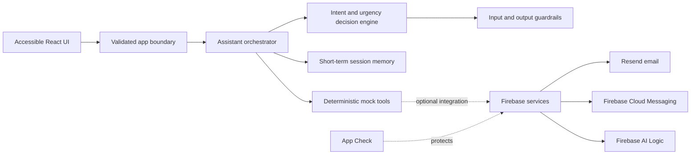
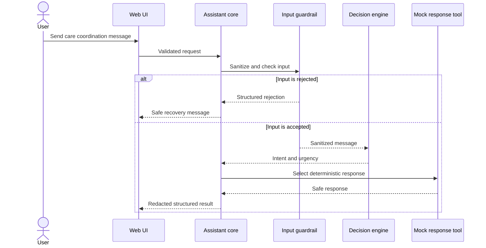

# Sanjeevani — Elder Care & Medication Coordination

> A shared, elder-first care space for organizing medication routines, appointments, and support from family and caregivers.

Built for the **PromptWars × Catalyst** challenge (Google for Developers, Build with AI).

## Project status

This repository contains the Sanjeevani workspace: an accessible React shell, shared TypeScript models, Firebase client setup for Authentication, Firestore, AI Logic, App Check, and Messaging, callable profile access functions, scheduled dose generation and reminders, and Firebase Hosting configuration. Connect a Firebase project and configure its console settings before using live services; the web app still needs feature screens and end-to-end flow wiring.

## 1. Problem and intended users

Older adults often coordinate medications, appointments, and care tasks across several people and channels. Missed or unclear handoffs can make routines harder to manage. Sanjeevani is intended for older adults first, with caregivers and family members included in a shared, permission-aware care circle.

The product helps organize care information. It does not diagnose, prescribe, recommend medication changes, or replace a clinician or pharmacist. If a person may be experiencing an emergency, the assistant should direct them to immediate local emergency help.

## 2. What exists and what is planned

| Area | Status |
|---|---|
| Accessible web workspace | Fully interactive; accessible care assistant chat, medication schedule adherence, appointments, and pill label OCR demo |
| Assistant core | Typed intent and urgency rules, input checks, response filtering, short-term in-memory session history, and deterministic responses |
| Offline behavior | Default mode requires no API key, Firebase project, or network service (Zero-friction evaluator testing) |
| Shared care profiles and role-specific access | Verified email sign-in/registration, profile creation/joining and switching; server-derived live roles and a separate demo role selector |
| Medication schedules and adherence logs | Morning/afternoon/evening/night timeline, full schedule editing, independent dose logging, and a seven-day adherence calendar |
| Appointment management and reminders | Timezone-aware appointments, preparation checklists, directions, Google Calendar links and offline iCal downloads; scheduled reminders implemented |
| Email and push delivery | Resend and FCM delivery path with bounded retries implemented |
| Pill-strip label check | Firebase AI Logic interactive verification demo with consent boundary and visible package text comparison |
| Automated test suite | 57 offline tests across the assistant, schemas, profile validation, dose scheduling, calendar exports, and frontend rendering |
| Hosting deployment | Firebase Hosting configuration serves the built React web app |

The offline core and web workspace provide a complete, safe foundation for elder care coordination.

## 3. Requirements traceability

| Requirement | Planned implementation | Status |
|---|---|---|
| Shared access for elders, caregivers, and family | Firebase Authentication, profile membership, server-verified role access | Service layer implemented; UI remains |
| View and manage medication schedules | Firestore medication service and shared model | Read/add service implemented; edit/delete UI remains |
| Track taken, missed, and skipped doses | Auditable dose logs and scheduled generation | Read/log/generation service implemented; adherence view remains |
| Manage upcoming appointments | Firestore appointment service and shared model | Read/add service implemented; edit/delete UI remains |
| Send proactive reminders | Scheduled Cloud Functions, Resend, Firebase Cloud Messaging | Handler implemented; credentials and live verification remain |
| Elder-first accessible experience | React web app with keyboard support, readable text, high contrast, and clear recovery messages | Starter shell available; feature screens planned |
| Reliable, secure behavior | Strict TypeScript, schema validation, guardrails, deterministic mock mode, and role-gated Firestore rules | Foundation in place; rule tests and live review remain |

## 4. Technology

| Layer | Technology |
|---|---|
| Language | TypeScript with strict compiler settings |
| Web | React and Vite |
| Assistant validation | Zod schemas and deterministic decision rules |
| Cloud backend | Firebase Cloud Functions and Admin SDK |
| Data | Cloud Firestore with member and role-based rules |
| Email and push | Resend and Firebase Cloud Messaging |
| AI verification | Firebase AI Logic with Gemini for visible package text only |
| Abuse protection | Firebase App Check with reCAPTCHA Enterprise |
| Tests | Vitest offline tests; Firebase Emulator Suite available for live integration review |

## 5. Architecture



The assistant core runs without Firebase or a model key. Risk and intent decisions are deterministic. Live calls require a configured Firebase project and App Check. Scheduled Cloud Functions use server-side validation and authorization.

### Assistant turn sequence



## 6. Repository structure

```text
Sanjeevani/
├── .env.example                 # Safe local configuration template
├── .env.emulator.example        # Local Firebase Emulator Suite settings
├── .gitignore
├── README.md
├── INSTRUCTIONS.md              # Hackathon constraints and coding rules
├── package.json                # npm workspaces and developer commands
├── firebase.json               # Hosting, Functions, Firestore, and emulator configuration
├── firestore.rules             # Membership and role-based access rules
├── firestore.indexes.json
├── src/                         # Assistant core package
│   ├── config.ts
│   ├── core/
│   │   ├── agent.ts
│   │   ├── decision_engine.ts
│   │   ├── memory.ts
│   │   └── persona.ts
│   ├── guardrails/
│   │   ├── input_validator.ts
│   │   └── output_filter.ts
│   ├── models/schemas.ts
│   └── tools/
│       ├── base.ts
│       └── mock_tools.ts
├── shared/
│   ├── schemas/                 # Validated medication and appointment inputs
│   └── types/                   # Cross-workspace care data models
├── web/
│   ├── src/lib/                 # Firebase, App Check, and notification setup
│   ├── src/features/auth/       # Email sign-in and profile callable clients
│   ├── src/features/profiles/   # Member profile lookup
│   ├── src/features/medications/# Schedule and dose-log access
│   ├── src/features/appointments/# Appointment access
│   ├── src/features/verification/# Firebase AI Logic label comparison
│   └── public/                  # App icon
├── functions/
│   ├── src/auth/                # Hashed role passcodes and profile membership
│   ├── src/reminders/           # Dose generation and email/push reminders
│   └── src/lib/                 # Structured logging and scheduling helpers
└── tests/                       # Vitest test suites (decision engine, guardrails, agent, schemas, config)
```

## 7. Quickstart

Requires Node.js 22.12 or newer. Firebase Emulator Suite and deployment commands also require Firebase CLI 15 or newer (`npm install -g firebase-tools`, then `firebase login`). From the repository root, install dependencies and start the local app:

```bash
npm install && npm run dev
```

Open [http://localhost:5173](http://localhost:5173). The starter page runs without credentials. `MOCK_MODE` and `VITE_MOCK_MODE` default to `true`; no Firebase project or model key is needed for the local demo.

To exercise Auth, Firestore, Functions, and Hosting locally, copy `.env.emulator.example` to `.env`, then run the emulators in one terminal:

```bash
npm run emulators
```

Start `npm run dev` in another terminal. The emulator project uses the demo ID `demo-sanjeevani`; it does not deploy to or modify a live Firebase project.

### Developer commands

| Command | Purpose |
|---|---|
| `npm run dev` | Start the Vite development server |
| `npm run emulators` | Start Firebase Auth, Firestore, and Functions emulators |
| `npm run typecheck` | Type-check configured workspaces |
| `npm run lint` | Run ESLint |
| `npm test` | Run 57 offline Vitest tests, including all 35 original tests |
| `npm run build` | Type-check and build the web and Functions workspaces |
| `npm run deploy` | Build and deploy Hosting, Firestore rules/indexes, and Functions to the selected Firebase project |
| `npm run deploy:hosting` | Build and deploy only the React app to Firebase Hosting |

### Frontend feature walkthrough

- **Medication Schedule:** view each dose in Morning (05:00–11:59), Afternoon (12:00–16:59), Evening (17:00–20:59), or Night. Times and dates use the active profile’s timezone. Marking one dose taken does not mark the medication’s other doses. The seven-day calendar distinguishes taken, missed, skipped, pending, and absent records.
- **Edit schedules:** the All Medication Schedules section includes paused and non-daily schedules. Edit preserves multiple times, selected weekdays, interval length, date limits, notes, and active status. Family members can view medications; elder/caretaker members can change schedules and log doses.
- **Appointments:** enter clinician-provided preparation instructions one per line. Checkmarks are saved only on this device and scoped to account, profile, and appointment; they are not shared with other members. Never infer fasting requirements from an appointment type. Calendar exports preserve the appointment instant and assume a clearly labeled 30-minute duration. The `.ics` download works offline; Google Calendar and directions links need internet.
- **Emergency help:** use the always-visible SOS control or an urgent chat prompt to open the drawer. Country-labeled phone links open the device dialer. The care-circle SMS/push broadcast is always a simulation, including in Firebase mode; it does not contact anyone or dispatch help. The default demo lists Priya and Rohan.
- **Account and Care Circle:** in Firebase mode, register, verify the emailed link, then sign in. Create a profile with an elder name, display name, and IANA timezone. Save its ID and three generated role codes before dismissing the result. Joining calls the existing server verifier; live roles cannot be selected locally. Use the profile selector to switch among memberships.
- **Offline demo:** no network or account is needed. Sample schedules/history are relative to the current date. Create additional sample profiles, switch among them, and try their generated role codes during the session. Demo data and codes are held in memory and reset on reload; checklist checkmarks remain device-local when storage is available.

Live dose logs are created by the existing hourly backend generator. New schedules show **Awaiting server schedule** until the corresponding log exists; use **Refresh doses** to load it. The UI updates the actual dose-log ID and does not attempt forbidden client-side log creation. Live load/write failures are shown explicitly; demo records are never substituted into a signed-in profile.

Dialogs use native modal focus containment and restore the initiating control’s focus. Controls have visible focus states and at least 44px targets, with responsive layout, large-text mode, and live status/error regions. Automated rendering checks do not replace browser keyboard/screen-reader review or live Firebase integration testing.

## 8. Environment variables

Use `.env.example` as the template. Keep real values in an ignored `.env` file or a managed secret store.

| Variable | Purpose |
|---|---|
| `MOCK_MODE` | Deterministic local mode; defaults to `true` |
| `VITE_FIREBASE_API_KEY`, `VITE_FIREBASE_AUTH_DOMAIN`, `VITE_FIREBASE_PROJECT_ID`, `VITE_FIREBASE_APP_ID` | Firebase web app configuration |
| `VITE_RECAPTCHA_ENTERPRISE_SITE_KEY` | reCAPTCHA Enterprise site key for live App Check |
| `VITE_FIREBASE_VAPID_KEY` | Public web-push key from Firebase project settings |
| `VITE_USE_FIREBASE_EMULATORS` | Connect the web SDK to local Firebase emulators |
| `VITE_MOCK_MODE` | Keep the browser app offline by default; set to `false` for Firebase services |
| `functions/.env` → `EMAIL_FROM` | Verified sender configured for Resend |
| `functions/.env` → `GRACE_MINUTES` | Missed-dose grace period; defaults to `30` and accepts `5`–`240` |

Set `RESEND_API_KEY` as a Firebase Secret. The Functions emulator can read `.secret.local`; never put the secret in a checked-in file.

## 9. Connect a Firebase project

The emulator project is separate from a live project. After choosing your Firebase project:

1. Run `firebase use --add` and select the project. This writes the non-secret project ID to `.firebaserc`.
2. Register a Firebase Web App and place its public config values in `.env` as `VITE_FIREBASE_*`.
3. In **Authentication → Sign-in method**, enable Email/Password. The app sends verification emails; configure its email template and authorized domains.
4. Create a Cloud Firestore database in the project. `npm run deploy` publishes the security rules and indexes.
5. In **AI Logic**, complete the setup flow for the Gemini Developer API. The app uses Firebase AI Logic with `gemini-3.8-flash`; it does not need a browser Gemini API key.
6. Register the Web App in **App Check** with a reCAPTCHA Enterprise site key. Put it in `VITE_RECAPTCHA_ENTERPRISE_SITE_KEY`, allow the production domain, and enable enforcement after checking request metrics.
7. In **Cloud Messaging → Web Push certificates**, create a VAPID key pair and put its public key in `VITE_FIREBASE_VAPID_KEY`.
8. Set the Resend secret with `firebase functions:secrets:set RESEND_API_KEY`. In ignored `functions/.env`, set `MOCK_MODE=false`, `EMAIL_FROM` to a verified sender, and optionally `GRACE_MINUTES`.
9. Run `npm run deploy` to build and deploy Hosting, Functions, Firestore rules, and indexes.

Scheduled reminders use Cloud Scheduler. Confirm the required APIs and billing setup for the selected project before deploying scheduled functions; see the [Firebase scheduling guide](https://firebase.google.com/docs/functions/schedule-functions).

## 10. Safety, privacy, and access control

- The assistant does not diagnose or provide directions to start, stop, or change medication.
- Potential emergency language receives a deterministic urgent response that directs the user to local emergency services and nearby human support.
- Input validation rejects common instruction override attempts; output filtering redacts common email, phone, payment-card, and identification-number patterns.
- Session memory is in-process and temporary. It is not durable storage and must not be treated as a medical record.
- Passcodes and attempt records are server-only; profile, medication, dose, appointment, and token rules require membership and role checks. Validate rules in the emulator before using real health data.
- Pill-strip images are sent to Firebase AI Logic only after the caller confirms consent. Gemini reads visible package text; it does not identify pills, verify contents, or confirm that a dose is safe.
- Never put API keys, access codes, or patient details in source control or logs.

## 11. Assumptions and edge cases

- The first release is a coordination aid for an elder and their trusted care circle; it is not a medical device.
- A message can be ambiguous, incomplete, adversarial, or too long. Requests are length-limited and common prompt override patterns are rejected.
- Possible emergencies take priority over routine scheduling intents. The system should route users to local emergency help rather than attempt to assess or treat symptoms.
- A missed-dose question must be referred to the medication instructions or a pharmacist/care team; the assistant does not decide whether to take a dose late.
- Time zone, daylight-saving, duplicate reminder, network failure, and retry behavior must be covered before scheduled reminders are enabled.
- Personally identifying information may appear in text; responses are filtered, and future persistence must use explicit access controls and data minimization.

## 12. Evaluation rubric mapping

| Rubric area from `INSTRUCTIONS.md` | Sanjeevani foundation |
|---|---|
| Vertical and persona | Elder-first care coordination scope and explicit safety limits |
| Decision-making | Typed intent and urgency state classification in `src/core/decision_engine.ts` |
| Layered architecture | UI, agent orchestration, decision engine, guardrails, tools, and memory are separate modules |
| Security guardrails | Zod input schemas, prompt-injection checks, PII redaction, membership and role-based Firestore rules |
| Offline mode | Deterministic mock response tool; no model key is required |
| Testing and verification | 57 offline Vitest tests covering the core, schemas, profile validation, timezone-aware schedules, calendar exports, and frontend rendering |
| Accessibility | Semantic landmarks, responsive layout, readable sizing, and visible focus treatment in the starter UI |
| Developer experience | npm workspaces, strict TypeScript, `.env.example`, and ignored build/cache artifacts |

## 13. Next implementation milestones

1. Complete end-to-end Firebase emulator and live-service verification of account and membership flows.
2. Add appointment editing and shared checklist completion if required.
3. Configure a Firebase project, App Check, FCM VAPID, and Resend secrets.
4. Expand backend reminder and Firestore security-rule coverage; measure the 85% coverage target.
5. Complete keyboard, screen-reader, and live-service reviews.

## 14. Limitations

Sanjeevani is a care coordination project, not a medical device. Firebase integrations require project configuration and have not been deployed or verified against a live Firebase project. Gemini can misread a label and cannot verify pill identity or safety; a caregiver or pharmacist must confirm any result. Health information is sensitive; review privacy, security, and applicable compliance requirements before using real patient data.

## 15. Team

**Team:** _[Team name]_

| Name | Role |
|---|---|
| _[Name]_ | _[Role]_ |

Built for the PromptWars × Catalyst challenge.
