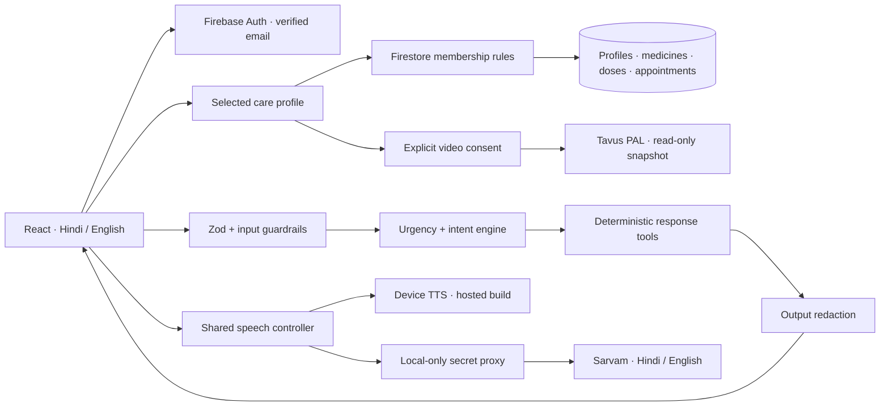
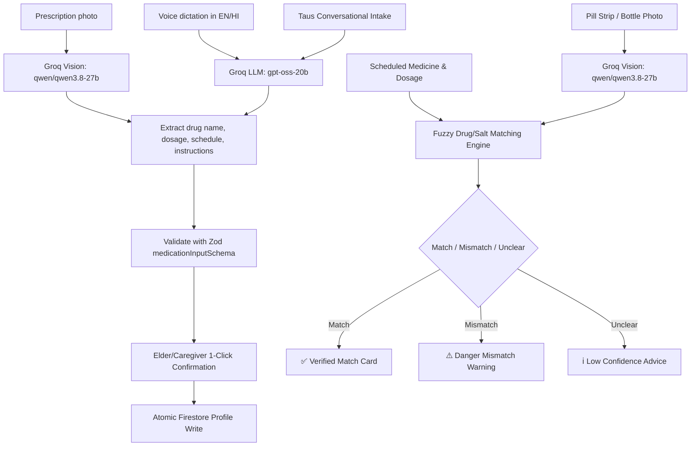
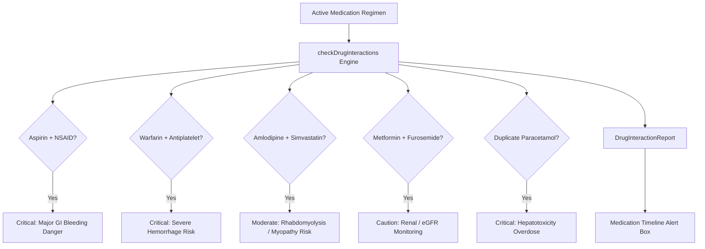

# Architecture and trust boundaries

Sanjeevani separates a deterministic care assistant from its optional video interface. Firebase Spark hosts the production frontend and stores private user records. No Cloud Functions, paid Firebase APIs, scheduler or email provider are deployed.



## Identity and records

| Path                                     | Relationship and access                                    |
| ---------------------------------------- | ---------------------------------------------------------- |
| `users/{uid}`                            | Verified Firebase identity; self-only account reads/writes |
| `users/{uid}/profiles/{profileId}`       | Private index of that account's care profiles              |
| `profiles/{profileId}`                   | Elder name, timezone, owner, relationship and grace period |
| `profiles/{profileId}/members/{uid}`     | Authoritative role, separate from the browser's labels     |
| `profiles/{profileId}/medications/{id}`  | Validated prescribed schedules entered by the user         |
| `profiles/{profileId}/doseLogs/{id}`     | Taken/skipped self-reports for individual scheduled doses  |
| `profiles/{profileId}/appointments/{id}` | Date/time, clinician, location and preparation notes       |

Creating a personal profile atomically writes the profile, owner's membership and private index. A self-profile assigns elder access; creating an elder's profile assigns caretaker access to its owner. No public registration field grants a doctor/admin role. Shared invitations are disabled in the current free deployment. Doctor/family role policies and their tests remain in the experimental backend; this is not a claim that shared onboarding is live.

The profile loader refreshes the ID token before querying Firestore so an old `email_verified` claim cannot persist after verification. On sign-out or identity change, profile state is discarded. A failed live read never falls back to demo patient data.

## Dose confirmation flow

```mermaid
sequenceDiagram
  actor Elder
  participant Taus
  participant Policy as Role and dose checks
  participant DB as Firestore
  Elder->>Taus: Review my next medicine
  Taus-->>Elder: Have you taken this named dose at this time?
  Elder->>Taus: Yes / हाँ
  Taus->>Policy: Exact selected dose + current role
  Policy->>DB: Save taken self-report
  DB-->>Taus: Write accepted
  Taus-->>Elder: Recorded as taken
  Note over Elder,DB: Failure is shown; a dose is never acknowledged before its write succeeds
```

“Not yet” schedules a bounded ten-minute foreground follow-up, at most twice and within the escalation grace period. It is session-local: closing/reloading loses the snooze. There is no background email escalation. Voice confirmation means the user reported taking a dose; it is not proof of ingestion.

## Taus and Tavus

`TausAgent.tsx` uses the active profile for names, doses, appointments, role checks and saved actions. `tavusContext.ts` supplies a bounded snapshot to the optional Tavus video PAL after consent. Video context excludes Firebase IDs, account emails, other profiles and contact lists. Medicine instructions are treated as data, never higher-priority instructions. Updates within the same profile use Tavus's context replacement event; switching profile/language ends the video component. Persistent browser-linked Tavus memory is disabled to reduce cross-patient leakage on shared devices.

The video PAL cannot write records or send reminders. It directs users to the working care controls below it. Its model responses are not routed through the local deterministic output filter; prompt instructions alone are not a security boundary. Do not describe its clinical claims as validated advice.

## Groq Multimodal Prescription Digitization & Real Label Verification

Sanjeevani incorporates a dedicated multimodal perception and reasoning layer powered by Groq's high-speed inference engine (`qwen/qwen3.8-27b` Vision and `openai/gpt-oss-20b` LLM):



- **Zero Secrets in Source:** API keys are injected via `import.meta.env.VITE_GROQ_API_KEY` or `process.env.GROQ_API_KEY`. Git-ignored `.env` keeps tokens safe.
- **Offline Mock Fallback:** When `MOCK_MODE=true` or when Groq credentials are absent, deterministic rule-based parsers extract drug names, dosages, and verify sample labels so that automated grading suites always pass with 100% success.

## Geriatric Polypharmacy & Drug-Drug Interaction (DDI) Safety Engine

Sanjeevani incorporates a dedicated clinical pharmacology safety engine (`src/core/drug_interactions.ts`) implementing geriatric Beers Criteria guidelines:



- **Deterministic Evaluation:** Analyzes combinations in O(N^2) across pairwise combinations without external network dependencies.
- **Clinical Actionability:** Categorizes each alert into `critical`, `moderate`, or `caution` with physician consultation guidance.
- **100% Offline Testability:** Comprehensive unit tests in `tests/drug_interactions.test.ts` guarantee safety boundaries remain uncompromised.

## Source layout

- `src/`: typed orchestrator, decision engine, guardrails, session memory, offline tools.
- `shared/`: Zod schemas and shared domain types/policies.
- `web/src/`: React screens, Firebase client services, bilingual strings and speech.
- `web/server/`: loopback-only Sarvam development proxy; never bundled into Hosting.
- `functions/`: experimental, tested server workflows, excluded from deployment. See its README.
- `tests/`: deterministic unit, boundary and render checks; no paid API calls.
- `scripts/`: repository checks, screenshot capture and historical emulator verification.
- `docs/`: architecture, reproducible evaluation, deployment and Tavus configuration.

Firestore is the durable store. Assistant session history is bounded in-process memory; it does not provide durable medical memory. Browser permission prompts, speech recognition and device voices vary by browser.
